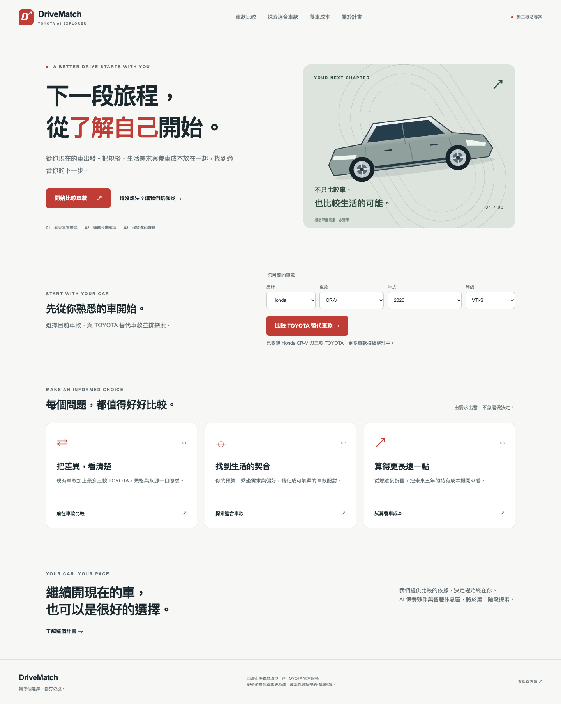
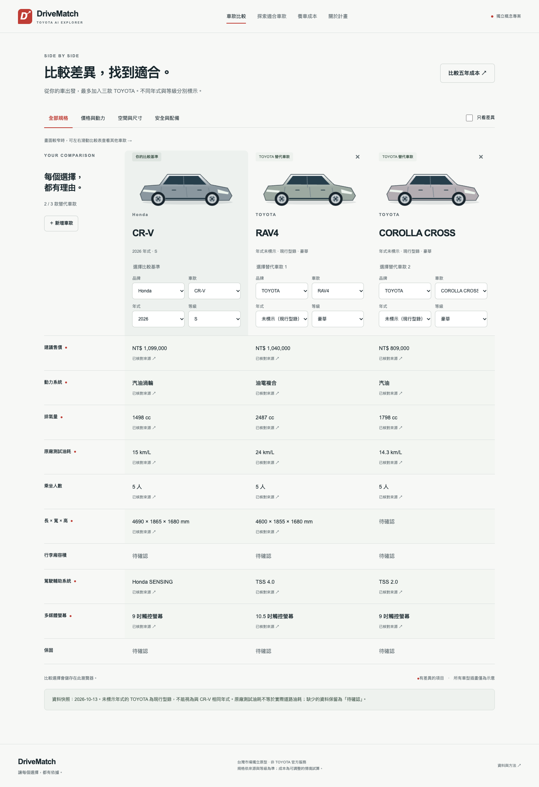

# TOYOTA AI DriveMatch

An independent, Traditional Chinese vehicle comparison MVP for Taiwan. **Not an
 official TOYOTA application.** Cycle 1 lets a customer select a Honda CR-V,
compare up to three TOYOTA alternatives, explore deterministic recommendations,
and estimate five-year ownership costs. No AI key or customer data is required.

## Application screenshots

Actual screenshots of the working Cycle 1 application. Click an image to view it
at full resolution.

**Homepage — choose your current vehicle and start exploring.**

[](docs/screenshots/home-desktop.png)

<details>
<summary>Vehicle comparison — Honda CR-V, TOYOTA RAV4 and COROLLA CROSS</summary>

[](docs/screenshots/compare-desktop.png)

</details>

Treat `docs/requirements.md` and `docs/architecture.md` as the project's source of truth. Before changing implementation details, inspect the existing codebase, preserve working functionality, and update the relevant documentation whenever requirements or architecture change.

## Run locally

Requirements: Node.js 24, Python 3.12+, npm. Dependency installation needs internet;
normal app operation uses the bundled catalog and needs no external services.

From the repository root:

```sh
python3 -m venv .venv
source .venv/bin/activate
pip install -r backend/requirements.txt
python -m uvicorn backend.app.main:app --host 127.0.0.1 --port 8100
```

In a second terminal:

```sh
cd frontend
npm ci
API_URL=http://127.0.0.1:8100 npm run dev -- --port 3100
```

Open **http://127.0.0.1:3100**. API documentation: **http://127.0.0.1:8100/docs**.
Ports 3100/8100 avoid conflicting with common local apps on 3000/8000.
Next.js reads API_URL at startup/build time. Restart after changing it.

## First milestone walkthrough

1. On the homepage, choose Honda → CR-V → 2026 → VTi-S or S.
2. Click “比較 TOYOTA 替代車款”. CR-V, RAV4 and COROLLA CROSS appear together.
3. Add CAMRY as the third alternative; inspect differences and source links.
4. Try the recommendation wizard; seven seats shows explicitly ineligible
   alternatives instead of pretending a five-seat vehicle satisfies the request.
5. Open ownership costs, adjust mileage and per-car assumptions, and compare
   keeping the existing vehicle against buying alternatives.

## Checks

```sh
python -m pytest backend/tests -q
python -m backend.app.import_catalog
cd frontend
npm run typecheck
API_URL=http://127.0.0.1:8100 npm run build
# With frontend and backend running, and Google Chrome installed:
npm run test:e2e
```

Playwright uses installed Google Chrome for desktop and mobile viewport tests.
Mobile tests emulate Chromium, not iOS Safari. For machines without Chrome,
install Chrome or adjust `channel` in `frontend/playwright.config.ts` to use a
Playwright-managed Chromium installation.

## Docker + PostgreSQL

```sh
cp .env.example .env
docker compose config --quiet
docker compose up --build
```

The database health check gates the idempotent seed importer; the API then uses
PostgreSQL rather than JSON. Frontend: port 3100; API: port 8100. Data persists
in the named volume. `docker compose down` preserves it. The provided password
is for local demonstration only; no database port is exposed to the host.

## Repository map

- `frontend/`: Next.js UI and Playwright acceptance tests.
- `backend/app/`: API, validated catalog, recommendation/TCO engines and importer.
- `backend/tests/`: business rules and API tests.
- `data/seed/vehicles.json`: reviewed catalog snapshot with per-field provenance.
- `docs/`: requirements, architecture, API, data, methodology and verification.
- `sysDesign.md`: original reference brief, preserved unchanged.

## Limitations

Only four models and five trim records are included. TOYOTA model years are
unknown in this snapshot and never inferred from publication dates. Some seat
counts use cited third-party specification pages. Cargo capacity, warranty and
some dimensions remain unknown. No live pricing or automatic source refresh.
All operating expense and resale assumptions are illustrative, editable inputs.

Cycle 2 (AI service companion, maintenance simulation, Smart Lounge, RAG and
LINE) is deliberately deferred. No accounts, saved cloud sessions or lead
submission are implemented. Comparison IDs are saved in browser localStorage.
No public website deployment has been performed. The private GitHub repository is
https://github.com/reviealnow/toyota-ai-drivematch. See
`docs/implementation-report.md` for executed checks.
